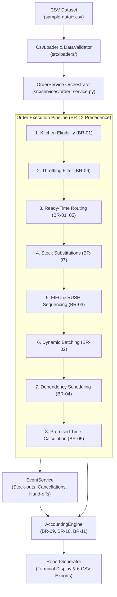

# Cloud Kitchen Multi-Brand Order Routing and Kitchen Capacity Engine

**Capstone Project | Team ID:** T080 | **Problem Statement:** PS-110  
**Team Members:** Pavan Neelappa Mirji & Padmavathi B  
**Academic Section:** CSD  
**IDE / Assistant:** Antigravity  
**Language:** Python 3.10+  

---

## 1. Project Title
**Cloud Kitchen Multi-Brand Order Routing and Kitchen Capacity Engine**

## 2. Problem Statement (PS-110)
In the modern food delivery ecosystem, multi-brand cloud kitchens (dark kitchens) operate multiple virtual restaurant brands under single physical kitchen roofs. During peak meal rushes, cloud kitchen operators face critical optimization bottlenecks:
- Which physical kitchen should fulfill an incoming customer order considering brand menus, delivery zones, and kitchen operating hours?
- How should limited culinary workstation capacity (Grill, Fryer, Wok, Cold, Bakery) be scheduled across simultaneous orders without exceeding slot limits?
- How can identical recipes ordered within narrow time windows be dynamically batched to maximize kitchen throughput?
- How should high-priority or high-value (RUSH) orders expedite through cooking queues without starving earlier regular orders?
- How should platforms account for channel commissions, packaging fees, GST, late hand-off penalties, and kitchen lease rents?

## 3. Project Objective
Develop a deterministic, modular, object-oriented Python backend engine that intelligently routes multi-brand food orders to eligible physical kitchens, schedules culinary workstation capacity, handles dynamic kitchen events (stock-outs, substitutions, cancellations, and hand-offs), and generates comprehensive financial and operational audit reports.

The engine operates without external databases, web frameworks (no Flask/Django), or Java dependencies, using clean Python dataclasses, in-memory discrete time-slot simulation, and CSV input/output.

## 4. Proposed Solution
The proposed solution implements a clean multi-layer pipeline:
1. **Schema & Referential Validation:** Ingests CSV catalogs and orders, validating cross-references, operating hours, and positive numeric constraints.
2. **BR-01 Eligibility & Routing:** Evaluates physical kitchens on 4 strict criteria (Brand, Zone, Hours, Stations), breaking ties deterministically by lowest projected ready time, lowest load, and kitchen ID.
3. **BR-06 Throttling Hysteresis:** Marks kitchens throttled when projected delay exceeds 60 minutes; recovers when load falls below 40 minutes.
4. **BR-07 Stock-Out & Substitution Pre-Processor:** Replaces unavailable ingredients if the substitute price difference is within ₹20; reprices or cancels orders if items cannot be fulfilled.
5. **BR-03 FIFO & RUSH Sequencer:** Orders queue by placement time; RUSH orders can jump ahead of up to 3 non-RUSH orders, while non-RUSH orders are shielded from more than 2 delays.
6. **BR-02 Dynamic Batching:** Groups identical recipes arriving within $\le 180$ seconds into shared station slots up to batch limits.
7. **BR-04 Topological Dependency Scheduler:** Ensures prerequisite recipes (e.g., burger patties) finish before dependent recipes (e.g., assembled burgers) begin.
8. **BR-05 Promised Time Calculator:** Adds transit time and a 5-minute buffer, rounding UP to the next 5-minute boundary, evaluating alternative kitchens if prep exceeds 45 minutes.
9. **BR-09, BR-10, BR-11 Financial Engine:** Accurately tallies aggregator commissions, packaging caps, GST, late delivery penalties, and monthly/daily kitchen rent with minimum volume thresholds.

---

## 5. Key Features
- **Deterministic Multi-Station Concurrency:** Discrete slot bookings on Grill, Fryer, Wok, Cold, and Bakery stations.
- **Topological Recipe Dependencies:** Enforces prerequisite completion before dependent assembly starts.
- **Fair Priority Queuing:** RUSH jumps (max 3) with strict anti-starvation protection (max 2 delays per order).
- **Dynamic Recipe Batching:** Automatically merges identical recipes within 3 minutes ($\le 180$s).
- **Dynamic Event Stream Processing:** Handles real-time stock-out, stock-in, cancellation (free before prep start vs charged after prep start), and courier hand-off events.
- **Auditable Financial Settlement:** Computes channel economics (Aggregator A 22%, Aggregator B 18%, Own App ₹15 fee), packaging cap (₹10/item, max ₹40), GST (5%), late hand-off penalties (₹50/10m block, max ₹200), and kitchen lease rent (₹2/order + 3% net food, ₹500 minimum threshold if $< 30$ orders).
- **Dual Reporting:** Generates human-readable terminal matrices and 6 standardized CSV audit reports.

---

## 6. Technology Stack
- **Language:** Python 3.10+ (tested on Python 3.14.7)
- **Standard Libraries:** `dataclasses`, `datetime`, `enum`, `pathlib`, `csv`, `math`, `typing`, `copy`, `argparse`
- **Testing Framework:** `pytest >= 8.0.0`
- **Architecture:** Object-Oriented, Layered Backend Pipeline (zero web or database dependencies)

---

## 7. System Architecture



---

## 8. Project Folder Structure

```text
T080-PS-110/
├── README.md                          # Project documentation and student viva guide
├── requirements.txt                   # Project dependencies (pytest)
├── .gitignore                         # Git exclusion rules
├── main.py                            # Root CLI convenience entry point
├── sample-data/                       # Illustrative sample CSV files
│   ├── kitchens.csv                   # 3 physical kitchens with operating hours & zones
│   ├── stations.csv                   # 14 culinary workstations (Grill, Fryer, Wok, Cold, Bakery)
│   ├── brands.csv                     # 4 virtual restaurant brands
│   ├── menu_items.csv                 # 13 retail menu items with recipes
│   ├── recipes.csv                    # 13 recipes with prep durations, batches & dependencies
│   ├── delivery_zones.csv             # 4 delivery zones with transit times & kitchen links
│   ├── zones.csv                      # Delivery zones alias
│   ├── substitutions.csv              # Brand substitution mapping
│   ├── orders.csv                     # 22 customer orders (normal, RUSH, multi-item)
│   └── events.csv                     # Stock-outs, cancellations, and hand-off events
├── output/                            # Generated audit CSV reports
│   ├── routing_decisions.csv          # Kitchen selection, reasons, ready/promised times
│   ├── station_timelines.csv          # Workstation slot booking timeline
│   ├── order_financials.csv           # Order food value, commissions, packaging, GST
│   ├── daily_brand_pnl.csv            # End-of-day Brand P&L and kitchen rent settlements
│   ├── kitchen_daily_reports.csv      # Kitchen operations, rent revenue, and penalties
│   └── channel_reports.csv            # GMV, commissions, and fees by channel
├── src/                               # Application source code
│   ├── __init__.py
│   ├── main.py                        # Primary CLI application entry point
│   ├── models/                        # Domain entities and dataclasses
│   │   ├── __init__.py                # Clean export of all 11 core models and enums
│   │   ├── kitchen.py                 # Kitchen entity, KitchenStatus, stockouts
│   │   ├── station.py                 # Station, StationSlot, SlotBooking, StationType
│   │   ├── brand.py                   # Brand catalog entity
│   │   ├── menu_item.py               # MenuItem entity
│   │   ├── recipe.py                  # Recipe entity
│   │   ├── order.py                   # Order entity, OrderStatus, Channel enum
│   │   ├── order_item.py              # OrderItem entity
│   │   ├── delivery_zone.py           # DeliveryZone entity
│   │   ├── station_schedule.py        # StationSchedule model
│   │   ├── batch.py                   # Batch model
│   │   ├── financial_record.py        # FinancialRecord, OrderFinancials, BrandDailyPnL
│   │   └── event.py                   # Event, EventType, CancellationSource
│   ├── loaders/                       # Data loading and integrity validation
│   │   ├── __init__.py
│   │   ├── csv_loader.py              # Robust CSV parser for catalogs, orders, events
│   │   └── data_validator.py          # DataValidator and schema verification
│   ├── routing/                       # Routing logic and eligibility
│   │   ├── __init__.py
│   │   ├── kitchen_eligibility.py     # BR-01 eligibility evaluation
│   │   └── order_router.py            # BR-01, BR-05, BR-06 router
│   ├── scheduling/                    # Culinary workstation capacity and scheduling
│   │   ├── __init__.py
│   │   ├── station_scheduler.py       # Slot reservation and dry-run simulation
│   │   ├── scheduler.py               # StationScheduler alias
│   │   ├── batching.py                # BR-02 dynamic batching within 180s
│   │   ├── dependency_manager.py      # BR-04 predecessor topological synchronization
│   │   └── order_sequencer.py         # BR-03 FIFO and RUSH priority queue
│   ├── services/                      # High-level domain services
│   │   ├── __init__.py
│   │   ├── order_service.py           # BR-12 end-to-end pipeline orchestrator
│   │   ├── substitution_service.py    # BR-07 stock-outs and substitution engine
│   │   ├── cancellation_service.py    # BR-08 free vs charged cancellations
│   │   └── event_service.py           # Real-time event processor
│   ├── accounting/                    # Financial settlement engine
│   │   ├── __init__.py
│   │   ├── accounting_engine.py       # BR-09 channel commissions, packaging, GST
│   │   ├── penalty_calculator.py      # BR-10 late delivery hand-off penalties
│   │   └── rent_calculator.py         # BR-11 kitchen lease rent and volume minimum
│   └── reporting/                     # Console outputs and CSV exporters
│       ├── __init__.py
│       └── report_generator.py        # CLI matrix and 6 CSV report writers
├── tests/                             # Comprehensive pytest test suite (67 passed tests)
│   ├── __init__.py
│   ├── test_models.py                 # Core domain model tests
│   ├── test_validation.py             # Schema and referential integrity tests
│   ├── test_routing.py                # Eligibility, tie-breaks, throttling tests
│   ├── test_scheduling.py             # Workstation capacity and dependency tests
│   ├── test_business_rules.py         # Dedicated tests for BR-01 through BR-12
│   ├── test_accounting.py             # Commission, packaging cap, GST, rent tests
│   ├── test_edge_cases.py             # Dedicated tests for all 8 mandatory edge cases
│   ├── test_kitchen.py                # Operating hours and station capability tests
│   └── test_order.py                  # RUSH qualification and jump limits tests
└── docs/                              # Project design and testing documentation
    ├── architecture.md                # System architecture and class diagrams
    ├── business_rules.md              # BR-01 to BR-12 detailed specifications
    ├── design_decisions.md            # Architecture Decision Records (ADRs)
    └── test_report.md                 # Full pytest execution and verification report
```

---

## 9. Installation Instructions

### Prerequisites
- Python 3.10 or higher.
- `pip` (Python package manager).

### Step 1: Navigate to Project Directory
```powershell
cd "c:\Users\Erica Work\Desktop\T080-PS-110"
```

### Step 2: Create and Activate Virtual Environment
On Windows:
```powershell
python -m venv .venv
.venv\Scripts\activate
```

### Step 3: Install Dependencies
```powershell
pip install -r requirements.txt
```

---

## 10. How to Run the Application

Execute the pipeline using Python:
```powershell
python -m src.main
```
Or specify custom input/output directories:
```powershell
python -m src.main --data-dir sample-data --output-dir output
```
Or run directly via root entry point:
```powershell
python main.py
```

---

## 11. CSV Input Format Schemas

| File Name | Mandatory Column Headers | Description |
| :--- | :--- | :--- |
| `brands.csv` | `brand_id,name` | Virtual restaurant brand catalog. |
| `kitchens.csv` | `kitchen_id,name,open_time,close_time,supported_brands,delivery_zones` | Operating hours, supported brand IDs, and delivery zones. |
| `stations.csv` | `kitchen_id,station_type,capacity` | Concurrency slot count per workstation type. |
| `recipes.csv` | `recipe_id,station_type,prep_minutes,max_batch_size,dependency_recipe_id` | Station requirement, prep time, batch limit, predecessor prerequisite. |
| `menu_items.csv` | `item_id,brand_id,name,price,recipe_id` | Retail item pricing and recipe link. |
| `delivery_zones.csv` | `zone_id,delivery_minutes,eligible_kitchen_ids` | Transit transit times and reachable kitchen IDs. |
| `orders.csv` | `order_id,brand_id,items,channel,delivery_zone,order_time,channel_priority` | Incoming customer orders with semicolon-separated items. |
| `events.csv` | `event_id,event_type,timestamp,order_id,kitchen_id,item_id,source,details` | Operational events (`STOCK_OUT`, `CANCEL`, `HANDOFF`, `END_OF_DAY`). |
| `substitutions.csv` | `brand_id,original_item_id,substitute_item_id` | Brand ingredient substitution rules for stock-outs. |

---

## 12. Implemented Business Rules (BR-01 through BR-12)

- **BR-01 Kitchen Eligibility & Routing:** A kitchen must support the brand, cover the zone, be open at order time, and have all required workstations. Evaluates lowest projected ready time, breaking ties by lowest active load, then lowest alphanumeric kitchen ID.
- **BR-02 Station Capacity & Batching:** Slot booking concurrency enforced. Identical recipes arriving within 3 minutes ($\le 180$ seconds) batch together up to `max_batch_size`.
- **BR-03 FIFO & RUSH Priority:** Baseline FIFO queue. RUSH qualifies if `channel_priority == True` or order value $> \text{Rs. 1,500}$. RUSH orders can jump at most 3 orders; non-RUSH orders cannot suffer more than 2 delays.
- **BR-04 Ready-Time Calculation & Dependencies:** Predecessors must finish before dependent recipes can begin ($\text{start}_B \ge \text{end}_A$). Ready time $= \max(\text{item completions}) + 3\text{ minutes packaging}$.
- **BR-05 Promised Time & Late Risk:** Promised time $= \text{ready time} + \text{zone delivery minutes} + 5\text{m buffer}$, rounded UP to the next 5-minute mark. If ready time exceeds order time $+ 45$ minutes, alternative kitchens are evaluated (rerouting requires saving $\ge 10$ minutes); otherwise accepts with `LATE_RISK`.
- **BR-06 Kitchen Throttling:** When projected ready delay exceeds 60 minutes, the kitchen is marked `THROTTLED` and accepts only orders where it is the sole eligible kitchen. Cleared when load falls below 40 minutes.
- **BR-07 Stock-Outs & Substitutions:** Replaces unavailable items if the substitute price is within ₹20 ($|\Delta P| \le 20.0$, exactly ₹20 allowed). Removes item if no substitute exists; cancels order if 0 items remain.
- **BR-08 Cancellation Rules:** Free before preparation starts. Charged for started items if cancelled after preparation starts. Aggregator cancellations charge the channel 100% of started items. Cancellation at the exact instant prep starts counts as started.
- **BR-09 Channel Economics:** Aggregator A: 22% commission; Aggregator B: 18% commission; Own App: 0% commission + ₹15 fixed payment fee. Packaging: ₹10 per item, capped at ₹40 per order. GST: 5% on food value.
- **BR-10 Late Hand-off Penalties:** ₹50 per started 10 minutes late, maximum ₹200. Charged to the brand, or to the kitchen cost centre if lateness arose from throttled routing.
- **BR-11 Kitchen Rent:** Brand pays kitchen ₹2 per order $+ 3\%$ of net food value. If daily orders at a kitchen are $< 30$, a minimum rent of ₹500 applies. Exactly 30 orders does not trigger the minimum.
- **BR-12 Sequential Execution Precedence:** Pipeline runs in strict order: Eligibility $\rightarrow$ Throttling $\rightarrow$ Routing by ready time $\rightarrow$ Substitutions $\rightarrow$ Sequencing $\rightarrow$ Batching $\rightarrow$ Dependencies $\rightarrow$ Promised Time $\rightarrow$ Accounting.

---

## 13. Testing Instructions

Run all 67 automated unit and integration tests using pytest:
```powershell
python -m pytest -v
```

To run individual test suites:
```powershell
python -m pytest tests/test_business_rules.py -v
python -m pytest tests/test_edge_cases.py -v
python -m pytest tests/test_accounting.py -v
```

---

## 14. Sample Output

```text
==========================================================================================
 10 SECONDS CAPSTONE PROJECT | TEAM T080 | PROBLEM STATEMENT: PS-110
 Cloud Kitchen Multi-brand Order Routing and Kitchen Capacity Engine
 Data Directory:   sample-data
 Output Directory: output
==========================================================================================

[1/5] Loading configuration and catalogs...
  -> Loaded 4 virtual brands
  -> Loaded 13 recipes
  -> Loaded 13 menu items
  -> Loaded 4 delivery zones
  -> Loaded 3 physical kitchens with 14 workstations
  -> Loaded 3 brand substitution rules
  -> Loaded 5 lifecycle events

[2/5] Ingesting and validating incoming orders...
  -> Loaded and validated 22 customer orders

[3/5] Executing routing, scheduling, priority jumps, and accounting...
  -> Successfully processed 22 orders through pipeline

[4/5] Pipeline execution results:

>>> MASTER ORDER ROUTING & FULFILLMENT MATRIX
-------------------------------------------------------------------------------------------------------------------
Order ID   Brand        Channel       Kitchen  Placed    Ready     Promised  Customer   Net Food   Status    
-------------------------------------------------------------------------------------------------------------------
ORD-101    B-01         AGGREGATOR_A  K-01     12:00:00  12:08:00  12:30:00  Rs.366.50  Rs.257.40  CANCELLED 
ORD-102    B-01         AGGREGATOR_B  K-02     12:02:00  12:08:00  12:30:00  Rs.125.50  Rs.90.20   HANDED_OFF
ORD-106    B-01         AGGREGATOR_A  K-01     12:08:00  12:17:00  12:40:00  Rs.1657.00 Rs.1201.20 SCHEDULED*
ORD-107    B-03         AGGREGATOR_A  K-01     12:10:00  12:29:00  12:55:00  Rs.587.00  Rs.421.20  SCHEDULED*
ORD-103    B-02         OWN_APP       K-02     12:05:00  12:15:00  12:35:00  Rs.471.50  Rs.430.00  SCHEDULED 
ORD-104    B-01         AGGREGATOR_A  K-02     12:06:00  12:17:00  12:40:00  Rs.241.00  Rs.171.60  CANCELLED 
...
-------------------------------------------------------------------------------------------------------------------
  * indicates RUSH Priority Order

[5/5] Exporting CSV audit reports...
  -> Reports written to: output/
     - routing_decisions.csv
     - station_timelines.csv
     - order_financials.csv
     - daily_brand_pnl.csv
     - kitchen_daily_reports.csv
     - channel_reports.csv

 Pipeline execution finished successfully.
```

---

## 15. Team Details

- **Capstone Team ID:** T080  
- **Problem Statement ID:** PS-110  
- **Team Members:**
  1. **Pavan Neelappa Mirji**
  2. **Padmavathi B**
- **Academic Section:** CSD  
- **Mentor / Guide:** Antigravity Senior Technical Mentor  
