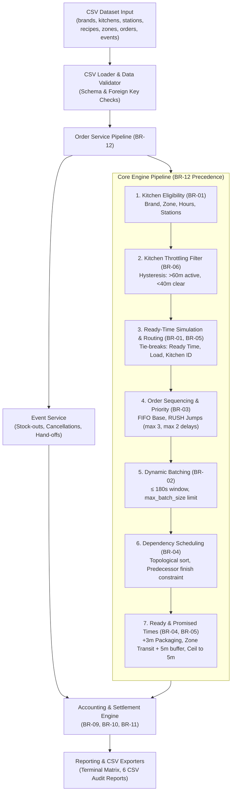
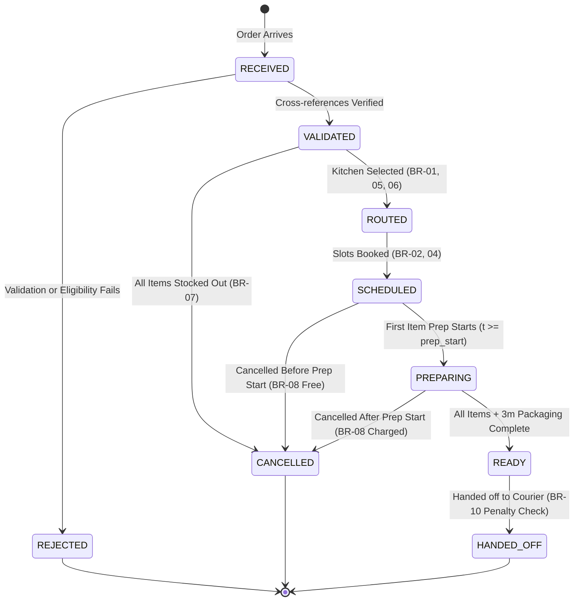

# System Architecture & Technical Design

**Project Title:** Cloud Kitchen Multi-Brand Order Routing and Kitchen Capacity Engine  
**Team ID:** T080 | **Problem Statement:** PS-110  
**Team Members:** Pavan Neelappa Mirji & Padmavathi B  

---

## 1. Architectural Philosophy & Overview

The system is a high-throughput, deterministic, database-free backend scheduling engine written in Python 3.10+. It coordinates multi-tenant virtual restaurant brands operating across physical cloud kitchens (dark kitchens). 

Rather than relying on heavy relational databases, transaction locks, or web frameworks, the engine uses **discrete time-window reservations**, **in-memory topological dependency graphs**, and **deterministic priority sequencing**.



---

## 2. Component Architecture & Layer Responsibilities

The application follows strict object-oriented layered architecture:

```
src/
├── models/           # Pure domain entities, enums, dataclasses (zero business logic side-effects)
├── loaders/          # Ingestion, parsing, structural and referential integrity validation
├── routing/          # Candidate kitchen filtering, ready-time estimation, late-risk evaluation
├── scheduling/       # Parallel slot booking, batch grouping, predecessor synchronization
├── services/         # Orchestration pipeline, substitutions, cancellations, and events
├── accounting/       # Channel commissions, packaging caps, GST, late penalties, kitchen lease rent
└── reporting/        # Human-readable terminal displays and standardized CSV audit exports
```

### 2.1 Domain Models (`src/models/`)
- `Kitchen`: Represents a physical facility with daily opening/closing times, supported brands, reachable delivery zones, and culinary workstations. Tracks operational status and item stock-outs.
- `Station` & `StationSlot`: Models culinary workstations (Grill, Fryer, Wok, Cold, Bakery) containing $N$ parallel concurrency slots.
- `Brand` & `MenuItem`: Virtual restaurant brands and catalog items linked to culinary recipes.
- `Recipe`: Defines the workstation type, preparation duration in minutes, maximum concurrent batch capacity, and optional prerequisite recipe dependencies.
- `Order` & `OrderItem`: Order entity with lifecycle timestamps, RUSH qualification metrics, scheduled slot mappings, and financial tallies.
- `DeliveryZone`: Transit transit times and permitted physical kitchens.
- `Batch`: Groups identical recipes placed within 3 minutes ($\le 180$ seconds) into a shared station slot.
- `FinancialRecord` / `OrderFinancials` / `BrandDailyPnL`: Financial snapshots recording food value, commissions, packaging fees, GST, rent, and penalties.

### 2.2 Routing Subsystem (`src/routing/`)
- `KitchenEligibilityChecker` (BR-01): Verifies 4 mandatory eligibility criteria: brand partnership, zone coverage, operational hours at order timestamp, and presence of all required stations.
- `OrderRouter` (BR-01, BR-05, BR-06): Evaluates candidate kitchens, applies hysteresis throttling filters, simulates projected ready times, breaks ties deterministically (ready time $\rightarrow$ load $\rightarrow$ kitchen ID), and checks alternative kitchens if projected prep exceeds 45 minutes.

### 2.3 Scheduling Subsystem (`src/scheduling/`)
- `OrderSequencer` (BR-03): Enforces baseline FIFO ordering by order placement timestamp. Identifies RUSH orders (`channel_priority == True` or order food value $> \text{Rs. 1,500}$) and allows them to jump ahead of up to 3 orders while preventing starvation by guaranteeing no order is delayed by more than 2 jumps.
- `BatchingEngine` (BR-02): Dynamically detects identical recipes arriving within $\le 180$ seconds and merges them into a shared cooking slot up to the recipe's batch capacity.
- `DependencyManager` (BR-04): Topologically sorts items so independent items (e.g. burger patty on grill) finish before dependent items (e.g. assembled burger on cold station) can begin.
- `StationScheduler` (BR-02, BR-04): Allocates discrete time windows `[start, end)` on specific station slots. Computes final order ready time as $\max(\text{item completions}) + 3\text{ minutes packaging}$.

### 2.4 Services Subsystem (`src/services/`)
- `SubstitutionService` (BR-07): Intercepts kitchen-specific stock-outs before scheduling. Replaces unavailable items with brand substitutes if $|\text{price}_{\text{sub}} - \text{price}_{\text{orig}}| \le \text{Rs. 20}$. Removes item and reprices if no valid substitute exists; cancels order if 0 items remain.
- `CancellationService` (BR-08): Handles cancellations. Free before preparation begins. If cancelled at or after the exact instant preparation starts, charges the customer for started items. If cancelled by an aggregator platform, charges the channel 100% of started item value.
- `EventService`: Sequentially processes discrete operational events (`STOCK_OUT`, `STOCK_IN`, `CANCEL`, `HANDOFF`, `END_OF_DAY`).
- `OrderService`: Pipeline orchestrator executing BR-12 precedence.

### 2.5 Accounting Subsystem (`src/accounting/`)
- `PenaltyCalculator` (BR-10): Computes late delivery penalties: Rs. 50 per started 10 minutes of lateness beyond promised time, capped at Rs. 200. Charges the Brand cost centre, or the Kitchen cost centre if lateness arose from throttled routing.
- `RentCalculator` (BR-11): Calculates kitchen rent: Rs. 2 per order $+ 3\%$ of net food value. Applies a Rs. 500 minimum fee if daily order volume is $< 30$. Exactly 30 orders does not trigger the minimum.
- `AccountingEngine` (BR-09): Computes Aggregator A (22%), Aggregator B (18%), Own App (0% + Rs. 15 fee), Packaging (Rs. 10/item, capped at Rs. 40), and GST (5% on food).

---

## 3. Order Lifecycle State Machine


