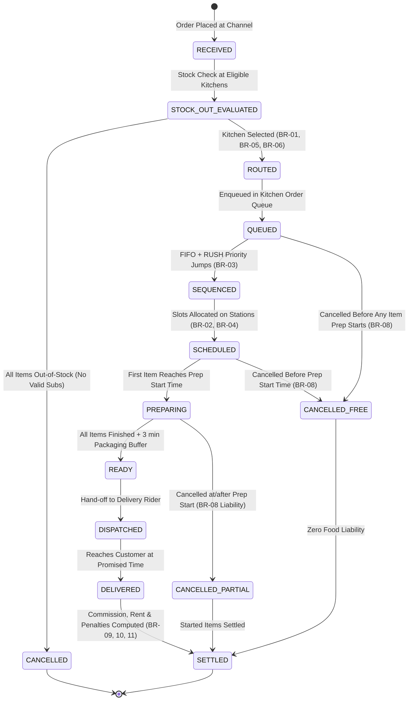

# Order State Diagram
**Team ID:** T080 | **Problem Statement:** PS-110  
**Project:** Cloud Kitchen Multi-brand Order Routing and Kitchen Capacity Engine  
**Team Members:** Pavan Neelappa Mirji & Padmavathi B (Section: CSD)

---

